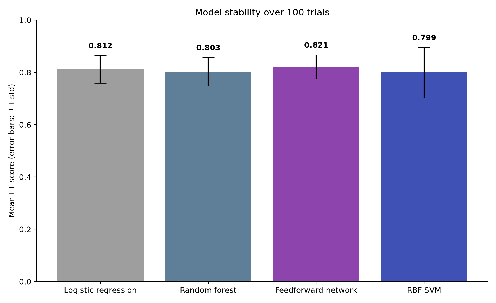
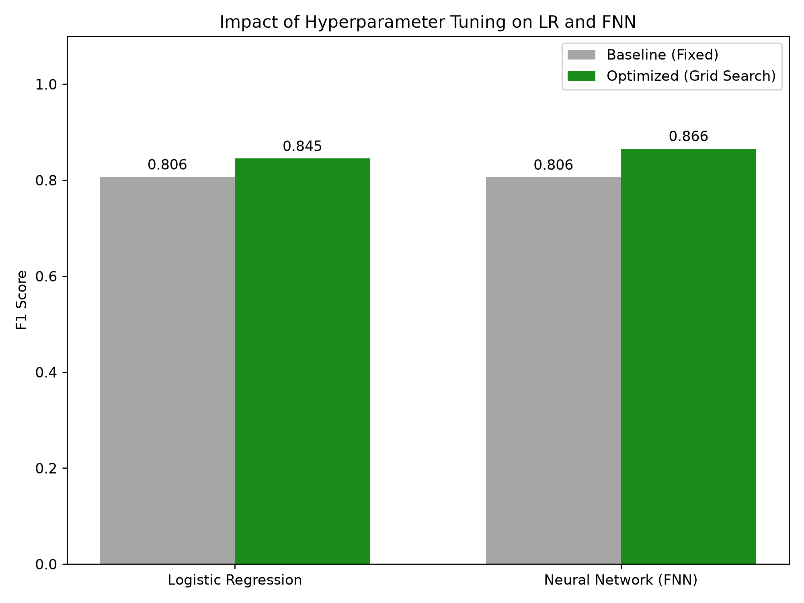

# Neural Shadows: Classifying Entanglement from Classical Shadows

Can a classical model tell entangled from separable two-qubit states using only a few randomized single-qubit measurements, without full state tomography? This project generates noisy Bell states, measures them with the classical-shadow protocol, and benchmarks four classifiers on the resulting features.

## Method

1. **States.** A Bell state |Φ⁺⟩ passes through a depolarizing channel, giving the Werner state ρ(p) = (1 − p)|Φ⁺⟩⟨Φ⁺| + p·I/4 with p drawn uniformly from [0, 1].
2. **Labels.** The exact concurrence C(ρ) sets the label: entangled if C > 0.1, separable if C ≈ 0. States with 0 < C ≤ 0.1 are dropped, which leaves a small gap around the entanglement boundary at p = 2/3.
3. **Measurements.** Each state gets T = 25 shadow snapshots. Each snapshot measures both qubits in a random Pauli basis (X, Y, or Z) and samples the joint outcome from the Born rule.
4. **Features.** Snapshots are inverted with the single-qubit shadow channel (3U†|b⟩⟨b|U − I), averaged into a 4 × 4 density-matrix estimate, and flattened into 16 real features.
5. **Models.** Logistic regression, a random forest and an RBF-kernel SVM (both grid-searched), and a small feedforward network (16 → 64 → 32 → 1, dropout 0.4), scored by F1 on a stratified 80/20 split of 250 states.

## Results

Over 100 Monte Carlo trials, each with a fresh dataset and split, all four models land within one standard deviation of each other:

| Model | Mean F1 ± std (100 trials) |
| --- | --- |
| Logistic regression | 0.812 ± 0.053 |
| Random forest | 0.803 ± 0.054 |
| Feedforward network | 0.821 ± 0.046 |
| RBF SVM | 0.799 ± 0.096 |

With 25 snapshots, the shadow-reconstructed density matrix already carries most of the usable signal, and a linear model is competitive. Extra model capacity does not buy measurable accuracy at this sample size.



The table and figure come from the same run, `python neural_shadows.py --seed 7`; per-trial scores are in [`data/stability_scores.csv`](data/stability_scores.csv).

A supplementary notebook grid-searches logistic regression and the network on one saved dataset. Gains from tuning on a single 50-state test split (shown below for the saved run) are about the size of the trial-to-trial spread above, so they are indicative only.



## Run it

```bash
git clone https://github.com/syedshubha/ShadowTomography
cd ShadowTomography
python -m venv .venv && source .venv/bin/activate
pip install -r requirements.txt

python neural_shadows.py --seed 7              # full run: 1 trial + 100 Monte Carlo trials
python neural_shadows.py --trials 10 --seed 7  # quick check (under a minute on a laptop CPU)
```

The script writes the dataset and both figures to `results/`. Flags: `--samples` (states per dataset, default 250), `--snapshots` (per state, default 25), `--trials` (0 skips the Monte Carlo study), `--seed`, `--outdir`.

| Path | Contents |
| --- | --- |
| [`neural_shadows.py`](neural_shadows.py) | Simulation, features, models, and both experiments as a command-line script |
| [`notebooks/neural_shadows.ipynb`](notebooks/neural_shadows.ipynb) | The original course notebook and its saved outputs |
| [`notebooks/hyperparameter_tuning.ipynb`](notebooks/hyperparameter_tuning.ipynb) | Grid search for logistic regression and the network on `data/` |
| [`data/quantum_shadow_dataset.csv`](data/quantum_shadow_dataset.csv) | 250 labeled feature vectors from the representative run |
| [`data/stability_scores.csv`](data/stability_scores.csv) | Per-trial F1 scores behind the stability table and figure |
| [`docs/neural-shadows-report.pdf`](docs/neural-shadows-report.pdf) | Full report |

## Author

[Syed Emad Uddin Shubha](https://syedshubha.com), Louisiana State University. Developed for CSC 7333 (Machine Learning), Fall 2025.

## License

The code, notebooks, and data are released under the [MIT License](LICENSE). The course report in `docs/`, which lists Joseph Masters as co-author, is not covered by this license.
